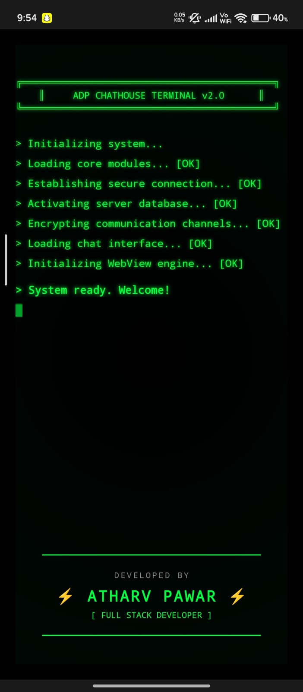
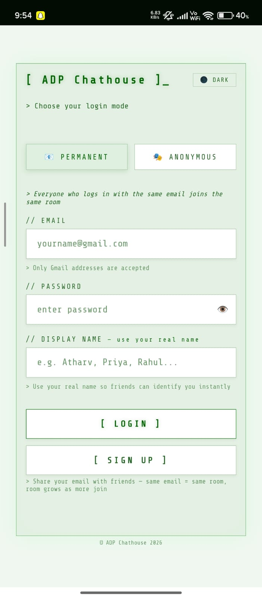
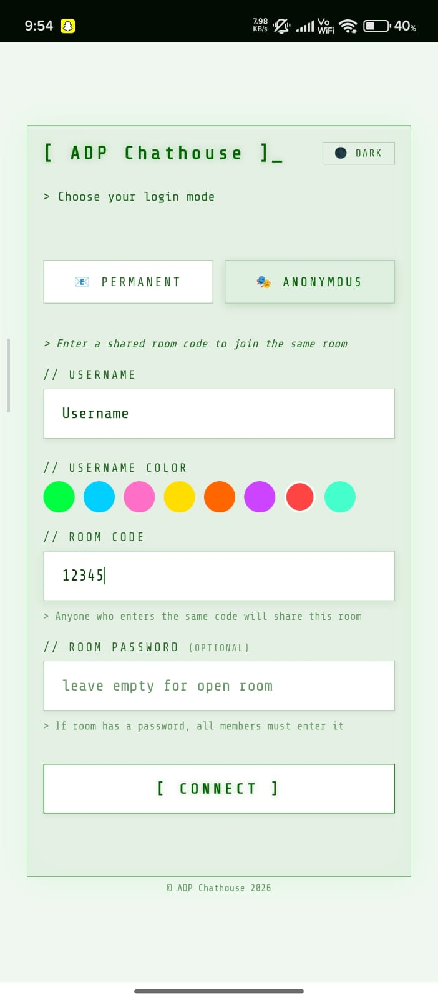
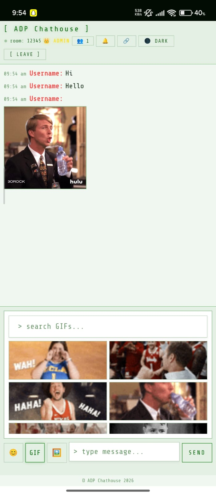

<div align="center">


# ADP Chathouse

A group chat app for Android with a green-on-black terminal look. No phone number, no social login.

[Download the APK (v1.0.0)](https://github.com/atharvpawar16/adpchathouse-app/releases/tag/v1.0.0) | [Project page](https://atharvpawar16.github.io/adpchathouse-app/)

[](https://github.com/atharvpawar16/adpchathouse-app/actions/workflows/android-build.yml) [](https://github.com/atharvpawar16/adpchathouse-app/releases/latest)

</div>

<div align="center">




</div>

<div align="center"><sub>Login, light mode, chat, a live room</sub></div>

## Why I built it

Most chat apps want your number or your social account before you can say hello. I wanted one where you pick a name, type a room code and you are talking. It also had to feel like a terminal, because that is the look I like.

## How it works

The chat itself is a web app (HTML, CSS and plain JavaScript) backed by Firebase. The Android app is a native shell around it: a WebView host, a splash screen, a file chooser for image uploads and a small bridge between JavaScript and Android. The same web app is also published as a project page.

## What you can do

- **Sign in with email and password** (Firebase Auth). The same email always lands in the same room.
- **Join anonymously** with a username and a room code, no account needed.
- **Lock a room** with a password.
- **Chat in real time** through Firebase Realtime Database.
- **Send images** up to 5 MB, emoji, and GIFs from the built-in picker.
- **Reply to and react to** messages, and see who is typing.
- **Moderate as room creator:** delete messages and manage people in the room.
- **Switch between** the dark terminal theme and a light theme.
- **See connection status**, with automatic reconnect, and an unread badge when you scroll up.
- **Share a room link** from inside the app.

## Stack

| Part | What |
|---|---|
| Android | Java, WebView, AndroidX. minSdk 24 (Android 7.0), targetSdk 34 |
| Web app | HTML, CSS, vanilla JavaScript |
| Backend | Firebase Authentication, Realtime Database, Hosting |

## Folders

```
app/src/main/java/com/adpchathouse/app/   MainActivity, SplashActivity, AndroidBridge
app/src/main/assets/                      the web app, manifest, service worker
app/src/main/res/                         icons, layouts, themes
functions/                                Cloud Functions placeholder
docs/                                     project page
screenshots/                              images used above
```

## Build it yourself

You need Android Studio (Hedgehog or newer) and JDK 17.

1. Clone the repo.
2. Create your own Firebase project with Authentication and Realtime Database turned on.
3. Put your `google-services.json` in `app/`. It is not in the repo.
4. Replace the Firebase config in `app/src/main/assets/index.html` with your own.
5. Run it on a device or emulator.

The GitHub Actions build uses a placeholder `google-services.json`, so its Android build checks compilation, not a connection to the production Firebase project. CI also checks web script syntax, JSON files and service-worker regression tests.

### Run the web checks

With Node.js 22 or newer, run these from the repository root. No npm install or extra dependencies are needed:

```sh
node scripts/check-web.mjs
node --test tests/*.test.cjs
```

The tests exercise shell installation, cache isolation, activation and network fallback in an isolated service-worker harness. They do not sign in or write to Firebase. Android device testing is still needed for picker behavior and WebView lifecycle changes.

## Notes on security

Firebase web keys are public by design. Access is controlled by Firebase Security Rules on the backend. The signing keystore and `google-services.json` are kept out of the repo.

## Next

Push notifications (FCM), message search, voice messages, profiles and avatars, end-to-end encryption.

## Install

Grab the APK from [Releases](https://github.com/atharvpawar16/adpchathouse-app/releases). You need Android 7.0 or newer and have to allow installs from unknown sources.

See [CHANGELOG.md](CHANGELOG.md) for history.

## License

Copyright (c) 2026 Atharv Pawar. All rights reserved. See [LICENSE](LICENSE).

Built by [Atharv Pawar](https://atharvpawar16.netlify.app/).
